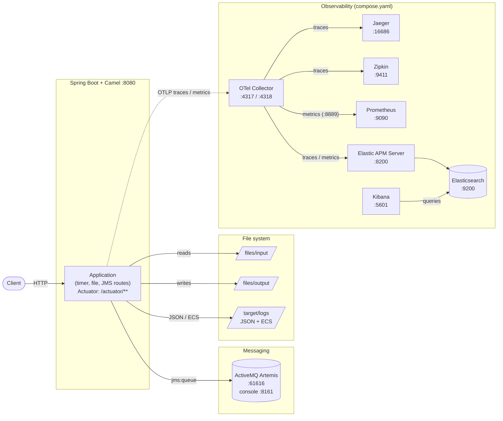

# camel-first — Apache Camel with Spring Boot

A hands-on learning project for Apache Camel on Spring Boot. It collects small, focused routes that
demonstrate message transformation, bean invocation, custom processors, JMS messaging, file
processing, structured logging and observability.

|  Component   | Version |
|--------------|---------|
| Spring Boot  | 3.5.x   |
| Java         | 25      |
| Apache Camel | 4.18.x  |

Based on the Udemy course
[Apache Camel Framework with Spring Boot](https://www.udemy.com/course/apache-camel-framework-with-spring-boot).
The course slides are in [doc/ApacheCamelPresentation.pdf](doc/ApacheCamelPresentation.pdf).

## Introduction

All routes are plain Camel `RouteBuilder`s registered as Spring components. They are meant to be read
and modified: each one shows a single concept, logs what it does, and can be enabled or disabled
individually. The application also demonstrates production-relevant topics — health checks,
request logging, metrics, distributed tracing with OpenTelemetry, and container/cluster deployment.

## Architecture



The timer routes write to the log endpoint, `MyFileRouter` bridges `files/input` and
`files/output`, and `ActiveMqSenderRouter` publishes to the Artemis queue. Traces and metrics are
exported via OTLP to the collector, which fans them out to Jaeger, Zipkin, Prometheus and the
Elastic stack (see `monitoring/`).

## Prerequisites

- JDK 25
- Docker (for the Artemis broker and the optional monitoring stack)
- IntelliJ IDEA (recommended) or any IDE; the project ships with ready-to-use run configurations in `.run/`

The Maven wrapper (`./mvnw`) is included, so no separate Maven installation is required.

## Run locally

The `local` profile is required; it contains the broker connection and all route toggles:

```bash
./mvnw spring-boot:run -Dspring-boot.run.profiles=local
```

The `local` profile enables Spring Boot Docker Compose support, so the services in `compose.yaml`
(Artemis plus the monitoring stack) are started automatically. To start only the broker and run the
application without the rest of the stack:

```bash
docker compose up -d jms
./mvnw spring-boot:run -Dspring-boot.run.profiles=local \
  -Dspring-boot.run.arguments=--spring.docker.compose.enabled=false
```

Useful endpoints:

|            What             |                                   URL                                    |
|-----------------------------|--------------------------------------------------------------------------|
| Application                 | http://localhost:8080                                                    |
| Actuator                    | http://localhost:8080/actuator                                           |
| Health (readiness/liveness) | http://localhost:8080/actuator/health                                    |
| Prometheus metrics          | http://localhost:8080/actuator/prometheus                                |
| Artemis console             | http://localhost:8161/console (user `artemis`, password `simetraehcapa`) |
| Artemis broker              | `tcp://localhost:61616`                                                  |

Sample requests for all actuator endpoints are in [restRequest/actuator.http](restRequest/actuator.http).

## Routes

|         Route          |                   ID                   |                                    Shows                                    |
|------------------------|----------------------------------------|-----------------------------------------------------------------------------|
| `MyFirstTimerRouter`   | `my-first-timer-route`                 | Calling a bean for transformation and processing, plus a custom `Processor` |
| `MySecondTimerRouter`  | `my-second-timer-route`                | `transform().method(...)` with a Spring bean                                |
| `MyThirdTimerRouter`   | `my-third-timer-route`                 | `transform().constant(...)`                                                 |
| `MyForthTimerRouter`   | `my-forth-timer-route`                 | Inline processor lambda in the DSL                                          |
| `ActiveMqSenderRouter` | `active-mq-timer-route`                | Sending to a JMS queue, with OpenTelemetry baggage handling                 |
| `MyFileRouter`         | `list-files-route`, `copy-files-route` | Listing `files/input` on startup and copying files to `files/output`        |

The timer routes fire every five seconds (the ActiveMQ route every ten). The file route logs each
picked-up file with name, path and size, then writes it to `files/output`; test files live in
`files/` and are described in [files/README.md](files/README.md).

## Configuration

Active profile and route switches live in
[src/main/resources/application-local.yaml](src/main/resources/application-local.yaml):

```yaml
application:
  camel:
    my-first-camel-route:
      enabled: true
    active-mq-route:
      enabled: true
    file-route:
      enabled: true
```

The same keys can be overridden as JVM properties, e.g.
`-Dapplication.camel.active-mq-route.enabled=false`. The `.run/` run configurations show working
examples, including one that disables all timer routes.

## Observability

- Spring Boot Actuator exposes health, metrics, info, environment and HTTP exchange endpoints; the
  `local` profile exposes all of them.
- `RequestLoggingFilter` logs incoming requests (payload and headers) and excludes
  `/actuator/health` by default.
- OpenTelemetry tracing is configured in `application-local.yaml` (W3C trace context and baggage,
  Logback MDC integration). The `compose.yaml` stack provides Jaeger (http://localhost:16686),
  Zipkin (http://localhost:9411), Prometheus (http://localhost:9090), Elasticsearch/Kibana
  (http://localhost:5601) and the OTel Collector.
- Logback writes JSON logs to `target/logs/spring.log` and ECS-formatted logs to
  `target/logs/spring-ecs.log`.

## Tests

```bash
./mvnw test        # unit and integration tests
./mvnw validate    # formatting checks (spring-javaformat, spotless, shfmt)
```

## Deployment

Kubernetes manifests are generated by Maven filtering into `target/k8s`, the Helm chart lives in
`helm-charts/`:

```bash
./mvnw clean install -DskipTests -Dskip.docker.build=true
kubectl apply -f target/k8s/
```

For the Helm-based deployment (namespace `camel-first`, actuator on port 30080) see
`helm-charts/` and the release rules in [pom.xml](pom.xml). CI/CD runs through the workflows in
[.github/workflows](.github/workflows): `maven-build.yml` (build, test, analysis, image publishing),
`release.yml` and `deploy-and-test-cluster.yml`.

## Sandbox

Development in an isolated Docker sandbox via
[opencode-sandbox-kit](https://github.com/dboeckli/opencode-sandbox-kit).
Prerequisites: `sbx` CLI, secrets (`sbx secret set github` + `sbx secret set github-maven`),
IntelliJ-MCP registration (`sbx mcp add idea --url http://localhost:64342/stream --skip-ssrf-check`).

Start (PowerShell) with a read-only host Maven cache (no re-download of cached dependencies):

```powershell
sbx run opencode `
    --kit "git+https://codeberg.org/dboeckli/opencode-sandbox-kit.git#dir=opencode-agent" `
    --template docker.io/domboeckli/sbx-opencode-tooling:latest `
    --skills=off `
    --static-mcp idea,k8s,docker `
    . `
    "C:\development\maven-repo:ro"
```

